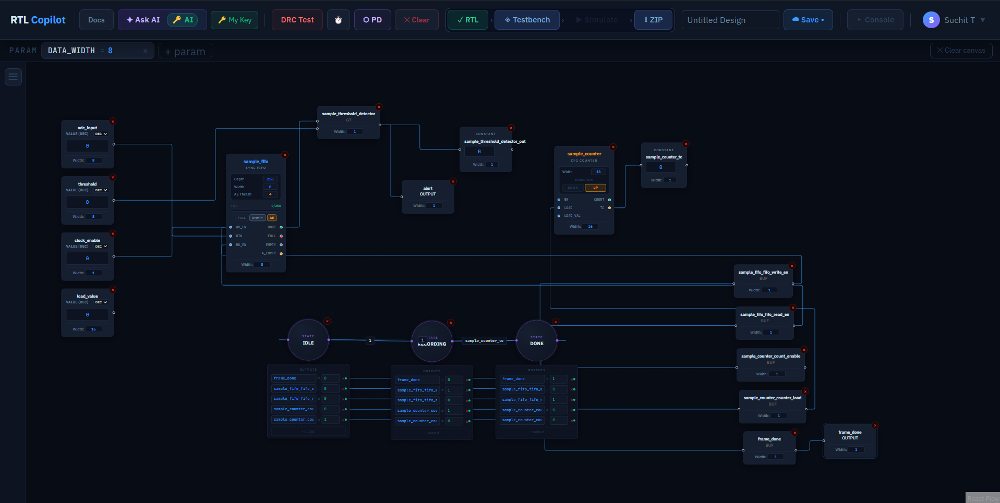
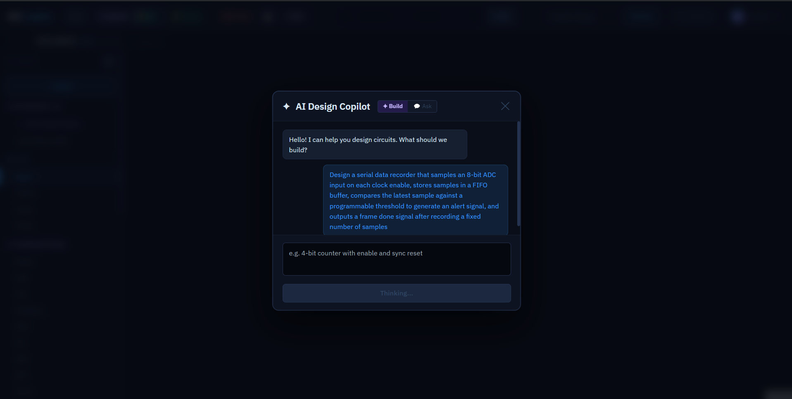
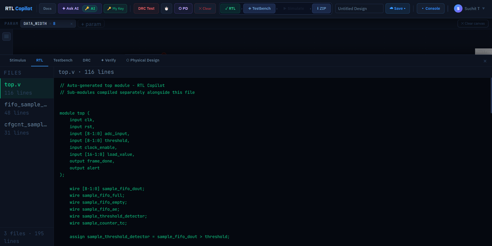
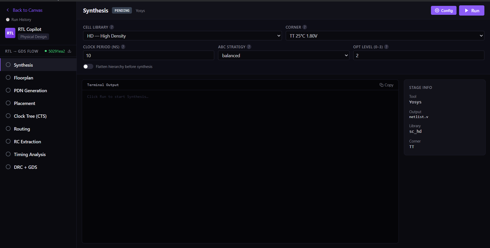

# RTLCopilot

**AI-assisted RTL design tool. Draw circuits visually, describe them in plain English, simulate, and take your design all the way to GDS — on your desktop.**

> RTLCopilot was created by [Suchit Tilak](https://github.com/Suchit18).

---

## What it does

RTLCopilot is an open source hardware design tool that lets you:

- **Draw circuits visually** — drag and drop logic blocks onto a canvas and wire them together
- **Generate Verilog with AI** — describe a circuit in plain English and get production-ready Verilog
- **Simulate** — run iverilog simulations with AI-assisted failure analysis
- **Create custom blocks** — define your own reusable Verilog blocks with a guided form
- **Full RTL to GDS** — synthesise, floorplan, place, route, and export GDS using open source EDA tools running in Docker
- **Intelligent verification** — automatic quality checks after each PD stage with deterministic fix suggestions and AI explanations
- **Layout preview** — view your chip layout at any stage directly in the tool

RTL Brain (the AI generation pipeline) is experimental. It works well for common circuit patterns and is actively being improved. Community contributions to RTL Brain are especially welcome.


## Screenshots


*AI-generated serial data recorder — FIFO, FSM, counter, threshold detector all wired automatically*


*Describe a circuit in plain English — RTL Brain decomposes and builds it on the canvas*


*Clean, hierarchical Verilog output — multiple sub-modules generated alongside top.v*


*Full RTL to GDS flow — Synthesis, Floorplan, Placement, CTS, Routing, DRC all in one tool*

---

## Information Page

[rtlcopilot.com](https://rtlcopilot.com)

---

## Tech stack

| Layer | Technology |
|---|---|
| Frontend | React, ReactFlow, Electron |
| Backend | FastAPI (Python) |
| Auth + DB | Supabase (optional — offline mode uses local JSON) |
| Port widths | Shared contract (`backend/port_contract.py`) consumed by backend and canvas |
| Verilog emit | Custom deterministic emitter (`backend/rtl_codegen/`) |
| Simulation | iverilog + vvp |
| AI | BYOK — bring your own OpenAI / Groq / NVIDIA NIM key |
| PD tools | OpenROAD, Yosys, KLayout, Sky130 PDK (via Docker) |

---

## Project structure

```
rtlcopilot/
├── backend/                    ← Main FastAPI backend
│   │
│   │  ── HTTP layer ──
│   ├── api.py                  ← FastAPI app, middleware, all 24 routes
│   ├── models.py               ← Pydantic request/response models
│   ├── core.py                 ← Config, paths, LLM client, auth, offline mode
│   ├── state.py                ← Process-wide mutable state (FSM tables, caches)
│   │
│   │  ── AI generation pipeline ──
│   ├── rtl_brain.py            ← Stage 0-3 pipeline + hierarchy assembler
│   ├── prompts.py              ← All LLM prompt templates + custom-block schemas
│   ├── block_mapper.py         ← Generic vocabulary → primitive block mapping
│   ├── known_circuits.py       ← Deterministic circuit hierarchies (no LLM)
│   ├── generation_errors.py    ← Explicit failure types returned to the UI
│   ├── legacy_hierarchical.py  ← Older decomposition path (fallback only)
│   │
│   │  ── IR and emission ──
│   ├── port_contract.py        ← Per-handle width contract — single source of truth
│   ├── ir_checks.py            ← IR design-rule checks + semantic annotation
│   ├── hierarchical_v2.py      ← Hierarchy → canvas nodes → Verilog
│   ├── net_ir.py               ← Net-level IR construction and validation
│   ├── verilog_tools.py        ← iverilog compile check, LLM repair
│   ├── semantic_library.py     ← Behavioral models for verification
│   │
│   ├── tests/
│   │   └── test_port_contract.py  ← Contract lint + known-circuit validation
│   │
│   ├── requirements.txt
│   ├── .env.example
│   └── rtl_codegen/            ← Verilog emitters
│       ├── emit_verilog.py
│       ├── emit_testbench.py
│       ├── emit_fsm.py
│       ├── emit_fifo.py
│       ├── emit_cfg_counter.py
│       └── ...
├── frontend/                   ← Electron + React canvas
│   ├── src/
│   │   ├── App.jsx             ← Main canvas shell + canvas DRC
│   │   ├── portContract.js     ← Client for the backend port width contract
│   │   ├── PDPage.jsx          ← Physical design flow UI
│   │   ├── components/
│   │   └── ...
│   ├── electron/
│   │   ├── main.js             ← Electron main process + Docker management
│   │   └── preload.js
│   ├── package.json
│   └── .env.example
├── pdtools/                    ← Physical design pipeline (runs in Docker)
│   ├── api.py                  ← PD server: synthesis → GDS + verification endpoints
│   ├── pd_verification.py      ← Stage check logic + deterministic fix suggestions
│   ├── verification_policy.json← Configurable thresholds for fix engine (no hardcoding)
│   ├── export_preview.py       ← KLayout script for layout PNG generation
│   ├── Dockerfile              ← OpenROAD + Yosys + KLayout + Sky130 PDK
│   ├── docker-compose.yml      ← Start PD tools with one command
│   └── work/                   ← PD run outputs (gitignored)
├── README.md
├── CONTRIBUTING.md
├── KNOWN_ISSUES.md
├── LICENSE
├── schema.sql                  ← Supabase table definitions
└── .gitignore
```

---

## The port contract

Bit widths used to be decided independently in several places — the block
mapper, the assembler, the IR checker, the Verilog emitter, and the canvas DRC
each carried their own table. They drifted, and the symptom was width-mismatch
errors on designs that were actually fine (or, worse, silently truncated logic
on designs that were not).

`backend/port_contract.py` now declares width once, per `(pattern, handle)`
pair:

```python
"macro_cfgcounter": {
    "inputs":  {"en": ONE, "load": ONE, "load_val": DATA},
    "outputs": {"count": DATA, "tc": ONE},
},
```

Everything resolves through it, including the browser — the canvas fetches the
contract from `GET /handle_contract` so the DRC panel checks exactly the rules
the emitter obeys.

Two things follow from this that are worth knowing when adding blocks:

- A `comb` node's `width` is its **operand** width. The output width comes from
  the op: comparisons (`eq`, `lt`, …) are 1 bit, `mul` is double, everything
  else matches the operands.
- A splitter's `width` is the **slice** width, not the source width.

`backend/tests/test_port_contract.py` lints the contract and validates every
entry in `known_circuits.py` against it. Run it after touching either:

```bash
cd backend && python3 tests/test_port_contract.py
```

---

## Local setup

### Prerequisites

- Python 3.10+
- Node.js 18+
- [iverilog](https://steveicarus.github.io/iverilog/) v12.0+ installed and on PATH — Windows: [download installer](https://bleyer.org/icarus/)
- [Docker Desktop](https://www.docker.com/products/docker-desktop/) (for PD flow)
- A free [Supabase](https://supabase.com) project (optional — not needed in offline mode)
- An API key from OpenAI, Groq, or NVIDIA NIM (BYOK)

---

### 1. Clone

```bash
git clone https://github.com/rtlcopilot/rtlcopilot.git
cd rtlcopilot
```

---

### 2. Database

> **Skip this step if using offline mode.**

Run `schema.sql` in your Supabase project's SQL editor to create all required tables.

Enable Google OAuth in your Supabase project:
**Authentication → Providers → Google → Enable**

---

### 3. Backend

**With Supabase (full mode):**

```bash
cd backend
cp .env.example .env   # Windows CMD: use "copy .env.example .env"
# Fill in SUPABASE_URL and SUPABASE_SERVICE_KEY in .env
pip install -r requirements.txt
uvicorn api:app --port 8080
```

**Without Supabase (offline/contributor mode):**

```bash
cd backend
cp .env.example .env   # Windows CMD: use "copy .env.example .env"
# Set OFFLINE_MODE=true in .env — no Supabase keys needed
pip install -r requirements.txt
uvicorn api:app --port 8080
```

Offline mode bypasses Google OAuth and uses a local JSON file for project
storage. It is implemented in `backend/core.py` (`_OFFLINE_MODE`,
`_get_current_user`, `_local_db_load` / `_local_db_save`). You still need an LLM
API key in the Settings panel for AI features to work.

**LLM timeouts.** Model calls default to a 90-second timeout with SDK-level
retries disabled, so a slow or cold-starting endpoint fails readably instead of
blocking the server. Self-hosted and on-demand providers (NVIDIA NIM, Ollama,
vLLM) load models on demand and may need longer:

```bash
LLM_TIMEOUT_SECONDS=120   # default 90
LLM_MAX_RETRIES=0         # leave at 0; the pipeline handles retries itself
```

---

### 4. Frontend

```bash
cd frontend
cp .env.example .env # Windows CMD: use "copy .env.example .env"
# Full mode: fill in VITE_SUPABASE_URL, VITE_SUPABASE_ANON_KEY, VITE_API_URL
# Offline mode: set VITE_OFFLINE_MODE=true and VITE_API_URL=http://localhost:8080
npm install
npm run dev
```

---

### 5. PD tools (Docker)

The physical design pipeline runs inside a Docker container with OpenROAD, Yosys, KLayout, and the Sky130 PDK pre-installed. The container is managed automatically by the Electron app — it starts when you open the Physical Design page and stops when you leave.

```bash
cd pdtools
docker compose up
```

This pulls the pre-built `rtlcopilot/pd-tools:latest` image from Docker Hub (~9GB) and starts the PD server on port 7070.

> **Note:** Docker Desktop must have at least 8GB RAM allocated.
> Settings → Resources → Memory → 8GB+

**For contributors (live file editing without rebuilding the image):**

The Electron app mounts your local `pdtools/` files directly into the container so changes take effect immediately on container restart. You do not need to rebuild the Docker image during development.

---

### 6. Set your API key

Click **🔑 Settings** in the toolbar and enter your OpenAI / Groq / NVIDIA NIM key. All AI features use your own key — no credits system.

---

## Physical Design flow

The PD flow runs sequentially through these stages. Each stage produces a DEF/GDS output that feeds the next.

```
Synthesis      → netlist.v          (Yosys)
Floorplan      → floorplan.def      (OpenROAD)
PDN Generation → pdn.def            (OpenROAD)
Placement      → placement.def      (OpenROAD)
CTS            → cts.def            (OpenROAD)
Routing        → routed.def         (OpenROAD)
RC Extraction  → output.spef        (OpenROAD)
Timing         → timing.rpt         (OpenROAD)
DRC + GDS      → drc.rpt, output.gds (KLayout)
```

Run outputs are written to `pdtools/work/{run_id}/` on your machine. All intermediate files are available for download from the stage info panel.

---

## Intelligent verification

RTLCopilot automatically checks the quality of each stage after it completes. No manual log reading required.

### How it works

After each checked stage (Synthesis, Placement, CTS, Routing), the tool:

1. Extracts real metrics from the tool output logs — cell count, chip area, WNS, utilization, DRC violations, wire length, clock skew, violation types by layer
2. Stores all metrics in `run_meta.json` alongside the run outputs
3. Evaluates checks against user-configured thresholds
4. Computes deterministic fix suggestions using a stepwise diagnostic algorithm
5. Makes an AI call only to explain the findings in plain English — the AI never computes values

### What gets checked

| Stage | Checks |
|---|---|
| Synthesis | Cell count, chip area, inferred latches, unmapped cells |
| Placement | Setup WNS, core utilization, GP overflow |
| CTS | Hold WNS, setup WNS post-CTS, clock skew, buffer count |
| Routing | DRC violations by category, antenna violations, wire length |

### User-configurable thresholds

Timing and utilization checks require you to set thresholds in the Config panel before they produce a verdict. This is intentional — what counts as acceptable depends on your design's clock target and density goals.

- **WNS Margin (ns)** — minimum positive slack you consider healthy
- **Max Utilization (%)** — maximum core utilization before routing risk

Until thresholds are set, checks display the extracted value with an "unset" indicator. The raw data is always shown regardless.

### Fix suggestions

When a check fails, the tool computes a specific fix using data from all previous stages — never a percentage multiplier on the current value. For routing DRC violations, the diagnostic follows this sequence:

1. Is cell density above 8%? → compute target die area from chip area (synthesis) at 4% density
2. Are shorts the dominant violation type? → increase congestion iterations first
3. Are spacing violations dominant? → reduce placement density
4. Are iterations already maxed? → escalate to density reduction
5. Is density already at the floor? → no fix available, look upstream

Fix values are editable before applying. Clicking Apply navigates to the relevant Config panel and sets the value — no manual copy-paste.

### Verification policy

All threshold constants used by the fix engine live in `pdtools/verification_policy.json`. Override any value without touching Python:

```json
{
  "die_density_limit_pct": 8.0,
  "die_density_target": 0.04,
  "max_congestion_iterations": 60,
  "density_floor": 0.3
}
```

For live overrides without restarting the container, place an edited `verification_policy.json` in `pdtools/work/` — the engine reads it on every evaluation call.

---

## Layout preview

After Placement, Routing, and DRC+GDS complete, a **View Layout** button appears in the stage info panel. Clicking it opens a full-screen layout viewer with:

- Scroll to zoom, drag to pan
- Reset view button
- Save PNG button

Each view is distinct:
- **Placement** — placed cell footprints with pin geometry, before routing
- **Routing** — same plus signal wires between cells
- **Final GDS** — complete chip with full standard cell geometry from the library merge

The preview PNG is cached and regenerates automatically when the source DEF or GDS is newer than the cached image.

---

## RTL Brain — AI pipeline

RTL Brain converts natural language circuit descriptions into Verilog through a 4-stage pipeline in `backend/rtl_brain.py`:

```
Stage 0 — Decompose prompt into generic blocks (closed vocabulary)
Stage 1 — Wire blocks and assign parameters
Stage 2 — Extract connectivity and signal list
Stage 3 — Generate FSM transition tables
```

Widths are **not** decided by the model. Stage 0 and Stage 1 choose blocks and
connections; every handle width comes from `port_contract.py`. Conflicts the
assembler cannot reconcile are collected in `hierarchy["width_conflicts"]`
rather than being passed to the canvas.

Requests that name a circuit in `known_circuits.py` skip the pipeline entirely
and build from a fixed hierarchy — deterministic, no LLM calls, identical every
time. Adding entries there is the highest-leverage contribution to generation
quality.

It is **experimental**. Known limitations are documented in
[KNOWN_ISSUES.md](KNOWN_ISSUES.md). Contributions to improve it are very
welcome.

---

## PD server endpoints

The PD server runs on `http://localhost:7070` and exposes:

| Endpoint | Description |
|---|---|
| `POST /synthesize` | Yosys synthesis |
| `POST /floorplan` | OpenROAD floorplan |
| `POST /pdn` | Power distribution network |
| `POST /placement` | Cell placement |
| `POST /cts` | Clock tree synthesis |
| `POST /routing` | Global + detailed routing |
| `POST /spef` | RC parasitics extraction |
| `POST /timing` | Static timing analysis |
| `POST /drc` | KLayout DRC + GDS export |
| `GET /check/{run_id}/{stage}` | Stage verification checks + fix suggestions |
| `GET /preview/{run_id}/{view}` | Layout PNG (placement / routing / gds) |
| `GET /run/{run_id}/meta` | Full run metadata |
| `GET /download/{run_id}/{filename}` | Download any run output |

---

## Acknowledgements

RTLCopilot builds on the shoulders of incredible open source projects:

- [Yosys](https://yosyshq.net/yosys/) — open source synthesis suite by Clifford Wolf
- [OpenROAD](https://theopenroadproject.org/) — open source RTL-to-GDS flow
- [KLayout](https://www.klayout.de/) — GDS viewer and DRC engine
- [Sky130 PDK](https://github.com/google/skywater-pdk) — open source process design kit by SkyWater and Google
- [iverilog](https://steveicarus.github.io/iverilog/) — open source Verilog simulator by Stephen Williams
- [ReactFlow](https://reactflow.dev/) — canvas library powering the visual designer
- [Supabase](https://supabase.com/) — open source Firebase alternative for auth and storage

RTLCopilot would not exist without these projects and the communities behind them.

---

## Contributing

See [CONTRIBUTING.md](CONTRIBUTING.md).

---

## License

AGPL-3.0 — see [LICENSE](LICENSE).

RTLCopilot was created by Suchit Tilak. Copyright (c) 2026 RTLCopilot Contributors.